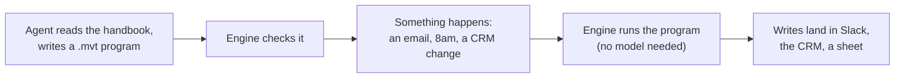

<!-- hero:start -->
# Listen-Fire

**The automation language for agents.**

Today your agent acts when you ask it to. Most of what you want done happens when you are not asking: an email arrives, it is 8am, a deal moves stage in the CRM. Having the agent handle each of those is another model call every time, and no two calls do quite the same thing.

With Listen-Fire the agent is asked once. Tell it "when I label an email Dealflow, add the company to Attio and tell #dealflow"; it writes a short program, checked against the real fields of your tools, and from then on every such email is handled the same way, with no agent in the loop and no tokens spent unless the program asks for AI.
<!-- hero:end -->

## How it works



1. **An agent writes a program**: a short text file (`.mvt`) in a language made for moving data between systems. A person can write or review one too.
2. **The engine runs it whenever that happens**, the same way each time. No model is needed to run a program; a program may call one for a single step (`ai(…)` to draft text, `extract(…)` to produce structured data from text).
3. **Every run is recorded**: the event it started from, what it read, and what it wrote.

## Fastest path to a first run

Install the `lf` command (macOS or Linux; it verifies the download and keeps the binary and its modules together):

```sh
curl -fsSL https://raw.githubusercontent.com/listen-fire/listen-fire/main/scripts/install.sh | sh
```

The archives it installs are on the [releases page](https://github.com/listen-fire/listen-fire/releases) if you would rather unpack one yourself; `cargo install listen-fire --version 0.12.0-rc.9` and, from a clone, `cargo build --release -p listen-fire` work too.

Then:

```sh
lf init my-project && cd my-project
lf check
lf run hello
```

```
$ lf run hello
run efde8ee1-… hello:hello completed — 0 write(s), 0 trace entries
  returned "Hello, <username>!"
```

`lf init` writes a project folder: `lf.yaml`, a starter program in `movements/hello.mvt`, and `.lf/` for run state and secrets. The starter listens to `manual`, a built-in source that fires when you run it by hand, so it needs no account and no key. `lf runs` lists every run and `lf runs show <run-id>` opens one.

[Getting started with `lf`](docs/getting-started-lf.md) goes on to connect a system (`lf connect @lf/attio`), add a credential, route a recorded event through your programs (`lf run --event …`) and serve webhooks (`lf serve`).

**What it connects to:** Slack, email and Gmail, WhatsApp, Telegram, Attio, Affinity, Airtable, Google Sheets, Google Drive, Dropbox, Granola meeting notes, a schedule, and your own system through a module ([connect anything](#connect-anything)).

**Where it runs:** as one binary on your machine; as the same binary split into a web-facing service and on-demand workers on cloud compute that can scale to zero; or inside your own Node or Rust product ([deploy options](#deploy-options)).

## The example program

A program **listens** to something in one of your systems and **fires** a named function in response. That is the whole shape of a program, and it is where the name comes from.

```
import { `@lf/email` as email, `@lf/attio` as attio } from adapters
import { acme_main } from credentials

inbox = connect email
crm   = connect attio using acme_main

function `Inbound Intake`(msg: <inbox-[:Email]->>) {
  write crm-[:Companies]-> {
    unique by (Name)
    Name: msg.Subject
  }
}

listen to inbox { key: "intake" } fire `Inbound Intake`
```

In plain English: every email that reaches the inbox becomes a company in the Attio CRM, named after the subject line, and an email with a subject already in the CRM updates that company instead of making a second one (`unique by`).

Each system is presented to the program as a graph of records joined by edges, so `<inbox-[:Email]->>` is "an email that arrived in the inbox", and `crm-[:Companies]->` is "the companies in the CRM". The program starts from the record that arrived, follows edges to related records, and writes along other systems' edges. The language lives in [`packages/movement-lang`](packages/movement-lang) and the handbook in [`packages/handbook/chapters`](packages/handbook/chapters); [`foundations.ts`](packages/handbook/chapters/foundations.ts) and [`anatomy.ts`](packages/handbook/chapters/anatomy.ts) are the two to start with.

## Worked example: CRM intake at a venture fund

Listen-Fire grew out of one job: keeping a venture fund's CRM up to date from email, meeting notes and Slack, without an associate retyping it. That job is the case study the rest of this README generalises from.

The fund's programs do what the example above does, and then what the language is for. A company that arrives by email lands in Attio once, however many times it is mentioned (`unique by`, with `FUZZY` matching so "Acme" and "Acme Inc" are one record). Meeting notes from Granola attach to the company they were about. The fields of an attached deck are pulled out with `extract(…)`, the one step that calls a model. A cold inbound waits for a partner's tap in Slack before it is added (the handbook's [reviews chapter](packages/handbook/chapters/asks.ts) covers waiting). [`examples/lf-attio`](examples/lf-attio) is a runnable Attio project with its own walkthrough.

## Deploy options

**One binary.** `lf serve` receives webhooks and callbacks, fires scheduled programs, polls systems that have no webhooks, and runs due work. Run state lives in SQLite under `.lf/`. This is enough for one machine. See [Getting started, section 6](docs/getting-started-lf.md#6-serve).

**Cloud, scaling from zero.** The same binary splits into two commands. `lf serve --doors-only` answers webhooks and callbacks by queuing them (so it suits compute billed by the request), and `lf drain --until-idle --max-seconds N` is a worker that claims queued work, runs it, and exits when nothing is due. State lives in Postgres, containers keep none, and any number of workers can drain at once. [`deploy/lf`](deploy/lf) holds the image and [its guide](deploy/lf/README.md) describes the platform shape: a service, a scheduled or queue-triggered job, and an optional wake module that starts a worker the moment work is due. A local trial runs under Docker Compose.

**Inside your product.** The engine runs in your own Node process as WebAssembly, with your product defined as one more system a program can read and write, each customer as a tenant, and every outside call answered by a host you build. [`docs/embedding.md`](docs/embedding.md) is the guide and [`examples/embed-saas`](examples/embed-saas) is a small HTTP app with an end-to-end test. The engine is a Rust crate too: [`examples/rust-embed`](examples/rust-embed) runs programs from a Rust host with its own tests.

**The hosted platform.** The web app, the API, the review pages and the agent connector that run programs for teams are a separate repository, `lf-platform`, in the same GitHub organisation.

## Talking to it from agents

The handbook is the interface an agent uses. It ships in this repository as data ([`packages/handbook`](packages/handbook)): a [front page](packages/handbook/front_page.ts) that names where the language differs from TypeScript and the few ideas it adds, chapters addressed by anchor, and a keyword search over built-ins, recipes and system behaviour. Every example on the front page is checked by the engine in the handbook's tests, so it cannot teach something that does not compile. The same content is published at [listen-fire.github.io/listen-fire/docs/next](https://listen-fire.github.io/listen-fire/docs/next/).

An agent's loop with `lf`:

1. Read the handbook's front page, then look up what the program needs.
2. Write the `.mvt` file into `movements/`.
3. `lf check`: every diagnostic names the rule it broke, with the file and line.
4. `lf run --event <recorded-event.json>`, or `--dry-run`, to see what the program would do; `lf runs show <run-id>` to read the trace.

The hosted platform exposes the same handbook, the search, and save, run and inspect to agents over MCP (the Model Context Protocol), so an agent in a chat can author and run a program without a terminal. For editors, `lf lsp` is a language server over stdio; [`docs/editor-zed.md`](docs/editor-zed.md) wires it into Zed.

## Connect anything

The engine knows no system. Everything a program touches is a module: a separate program that presents one system as records joined by links, and that handles its sign-in, rate limits and paging. A project installs the modules it needs (`lf connect @lf/attio`), and a program imports only what is installed. Two sources are built in and need nothing: `manual`, a run you start by hand, and `cron`, a schedule.

The ready-made modules in this repository today, each a starting point rather than a fixture of the language:

| module | system |
|---|---|
| `slack` | Slack |
| `email` | inbound and outbound email |
| `gmail` | one Gmail mailbox, read and written as itself |
| `whatsapp` | WhatsApp, via the Meta Cloud API |
| `telegram` | Telegram, via the Bot API |
| `attio` | Attio |
| `affinity` | Affinity |
| `airtable` | Airtable |
| `google_sheets` | Google Sheets |
| `google_drive` | Google Drive |
| `dropbox` | Dropbox |
| `granola` | Granola meeting notes |
| `evertrace` | Evertrace |
| `dealroom` | Dealroom |

Any other system is a module away. A module is an HTTP server speaking a [versioned protocol](docs/contracts/adapter-protocol.md), in whatever language you like: [`examples/lf-acme`](examples/lf-acme) is a CRM adapter in one JavaScript file, and [`examples/rust-module`](examples/rust-module) serves an adapter and a plugin from Rust. A project reaches a module through a folder in `externals/` that says how: a command the host starts, a URL already serving, or a package.

The same holds for everything else the engine needs. Where runs are stored, which models answer `ai(…)`, where files go, what settles whether two records are the same, how workers are woken: each is a [slot](docs/core-slots.md) a module fills, with a default that needs no setup and an alternative you can swap in or write. Plugins add functions a program can call: `@lf/pdf` renders one, and [`examples/lf-custom-plugin`](examples/lf-custom-plugin) adds your own.

## Repository layout

This repository is the language: the parser, checker and engine (Rust, compiled to WebAssembly), the `lf` command, the modules that connect systems, and the embedding kit. It serves the language of its own release; upgrading an older program is the platform's.

- [`crates/`](crates): the Rust crates: parser, checker, engine, language service, module wire and kit, and the `lf` command (`crates/lf`).
- [`packages/movement-lang`](packages/movement-lang): the wasm artifacts, their bindings, the version table, the expression AST and the catalog types.
- [`packages/movement-engine`](packages/movement-engine) (`@listen-fire/engine`): the host contract, the Rust shim and the embed kit. [`packages/engine-contracts`](packages/engine-contracts), [`packages/module-kit`](packages/module-kit) and [`packages/module-runtime`](packages/module-runtime): the contracts and kits modules are written against.
- [`packages/handbook`](packages/handbook): the language handbook.
- [`modules/`](modules): the modules that connect systems.
- [`apps/cli`](apps/cli): the `lf` command's TypeScript tests and fixtures.
- [`examples/`](examples): runnable projects: an `lf` project, the Attio walkthrough, a custom plugin, the embedded engine in Node and in Rust, and a module served from Rust.
- [`docs/`](docs/README.md): the guides and the versioned contracts. [`docs/positioning/`](docs/positioning): the hero variants for positioning tests.

## Developing

[`CONTRIBUTING.md`](CONTRIBUTING.md) covers setup, the tests and how to release.

## Licence

Apache License 2.0. See [`LICENSE`](LICENSE), and [`NOTICE`](NOTICE) for third-party attributions.
